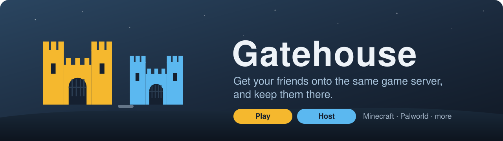
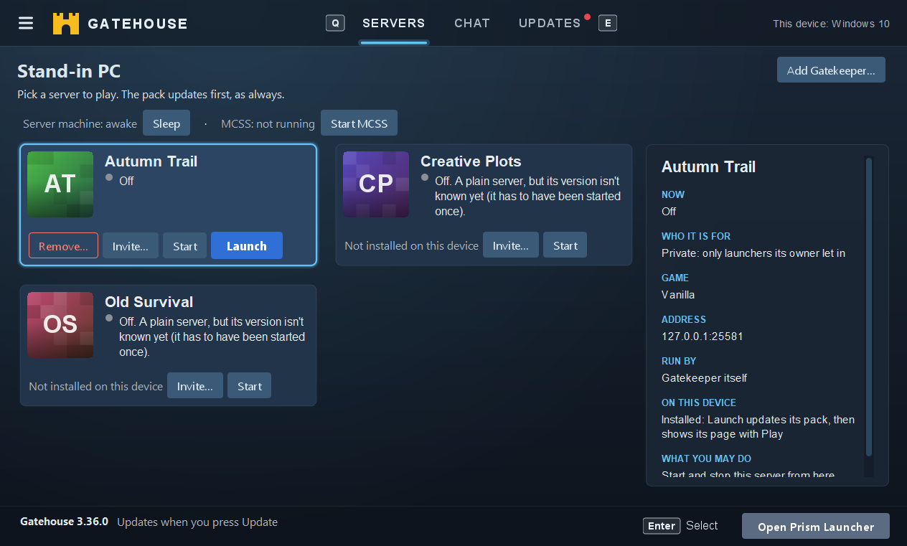
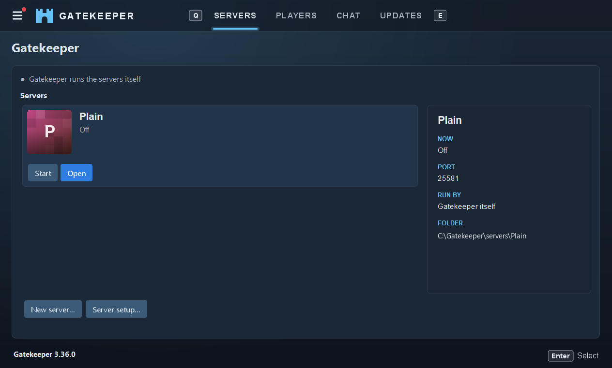
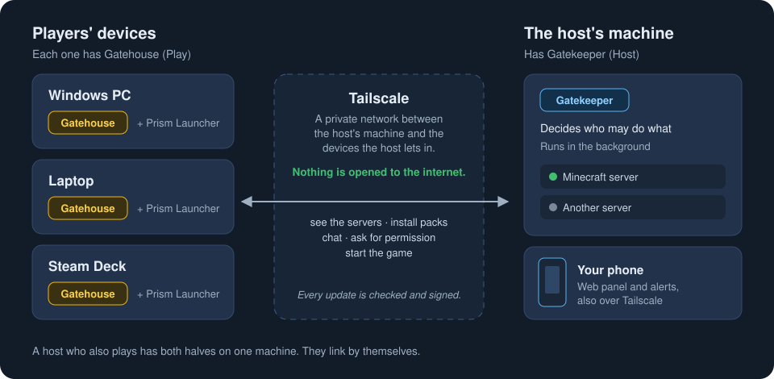
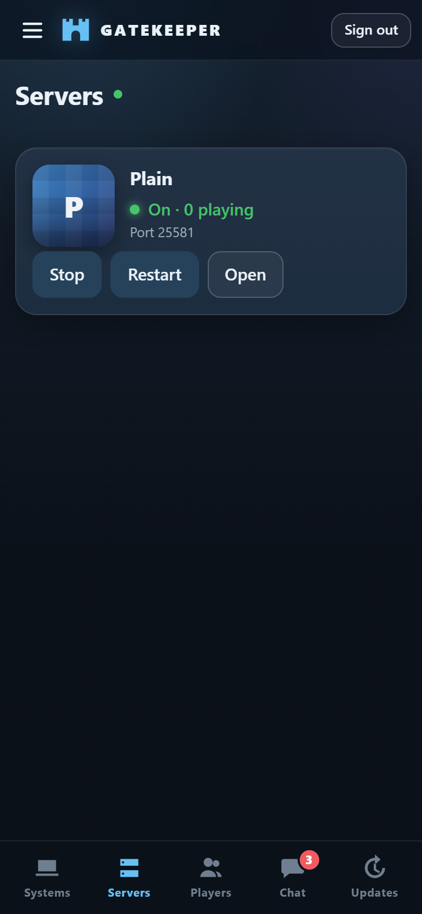
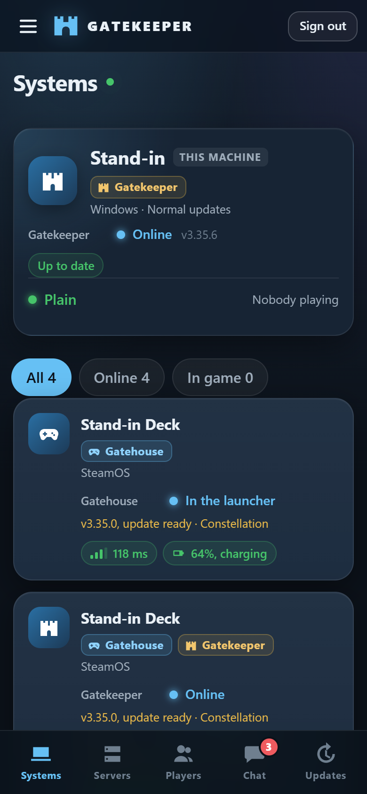

  

  
  
  
  

Gatehouse gets a group of friends onto the same game server and keeps them there: Minecraft (with or without mods),
Palworld, and more games to come. It is one program with two halves:

- **Play**, the Gatehouse launcher, on each player's device: the servers you can join, their mods installed and kept
  up to date, what changed, chat, and the server controls the host allows you. It starts the game through
  [Prism Launcher](https://prismlauncher.org/) or Steam.
- **Host**, Gatekeeper, on the machine that runs the servers: who may see, start and stop which server, the
  whitelist, new servers, backups, a web panel, and phone notifications. It works with
  [MC Server Soft](https://www.mcserversoft.com/) on Windows, or runs the servers itself.

Devices talk over the host's private [Tailscale](https://tailscale.com/) network, so nothing is opened to the
internet. Every update is checked against its published checksum and release signature.

Current version: **Gatehouse 3.43.0**, both halves.

<table>
  <tr>
    <td width="50%"></td>
    <td width="50%"></td>
  </tr>
  <tr>
    <td align="center"><b>Play</b>: every server you may join, with its state and what you may do there</td>
    <td align="center"><b>Host</b>: your servers, who runs them, and a new one in a few clicks</td>
  </tr>
</table>

## What it does

<table>
  <tr>
    <td width="33%" valign="top"> <b>One button to play</b> Launch installs or updates the server's pack first, then starts the game.</td>
    <td width="33%" valign="top"> <b>Host from your own PC</b> Start, stop and make servers, with MC Server Soft or on their own; on Linux and the Steam Deck too.</td>
    <td width="33%" valign="top"> <b>You decide who gets in</b> Private, shareable or public servers, invite links, the whitelist, and what each player may do.</td>
  </tr>
  <tr>
    <td valign="top"> <b>Always the same version</b> Packs and the program update themselves, so nobody is turned away for an old mod.</td>
    <td valign="top"> <b>Private and signed</b> Over your own Tailscale network; every download checked against its checksum and signature.</td>
    <td valign="top"> <b>Packs without the fuss</b> Make a pack from a server's mods folder, or find mods on Modrinth and add them.</td>
  </tr>
  <tr>
    <td valign="top"> <b>Chat</b> Rooms for the host and players, with pictures and files, on every device.</td>
    <td valign="top"> <b>From your phone</b> A web panel to manage servers, and notifications when someone joins or a server goes down.</td>
    <td valign="top"> <b>Backups</b> Back up a server's world before anything changes, kept beside it.</td>
  </tr>
  <tr>
    <td valign="top"> <b>Made for the couch</b> A game-like window that works with a controller and the Steam Deck's trackpads.</td>
    <td valign="top"> <b>More than Minecraft</b> Palworld servers installed and run for you; other games described in a small file.</td>
    <td valign="top"> <b>A helper that stays home</b> With Ollama on your PC, an AI answers questions in chat and explains crashes. Nothing leaves the machine.</td>
  </tr>
</table>

## How it fits together

## Start here

| | |
| --- | --- |
| **[User guide](docs/user-guide.md)** | The easy way in: playing, hosting and your phone, step by step with pictures |
| **[Getting started](docs/getting-started.md)** | Installing, your first server, inviting friends |
| **[Using Gatehouse](docs/gatehouse.md)** | Play: the window, a server's page, updates, controllers |
| **[Using Gatekeeper](docs/gatekeeper.md)** | Host: every page and option |
| **[Security and privacy](docs/security.md)** | Tailscale, permissions, signatures, what is sent where |
| **[Troubleshooting](docs/troubleshooting.md)** | When something doesn't work, including the Steam Deck |
| **[For developers](docs/developers.md)** | Building, the tests, publishing, signing, the update contract |
| **[Version history](docs/version-history.md)** | Every version of the program |

## Download

| You want | Windows 10 or later | Linux, including Steam Deck / SteamOS |
| --- | --- | --- |
| **Gatehouse** (to play) | [gatehouse-install.zip](https://github.com/scholar-andrew/gatehouse/releases/latest/download/gatehouse-install.zip): unpack, run **Install Gatehouse.cmd**, choose Gatehouse | [gatehouse-install.sh](https://raw.githubusercontent.com/scholar-andrew/gatehouse/main/installer/gatehouse-install.sh): `bash gatehouse-install.sh` |
| **Gatekeeper** (to host) | The same zip: choose Gatekeeper | The same script: `bash gatehouse-install.sh --gatekeeper` |
| **October Journey** (Gatehouse, the modpack and Steam shortcuts in one) | [GatehouseSetup.exe](https://github.com/scholar-andrew/gatehouse/releases/latest/download/GatehouseSetup.exe) | [gatehouse-setup.sh](https://github.com/scholar-andrew/gatehouse/releases/latest/download/gatehouse-setup.sh) |

The installers are plain scripts you can read first. They need no administrator rights, check each download
against a published SHA-256, and have a dry run that shows what they would do. All versions:
[Releases](https://github.com/scholar-andrew/gatehouse/releases).

| | Windows | Linux | SteamOS (Steam Deck) |
| --- | --- | --- | --- |
| Gatehouse | Yes | Yes | Yes |
| Gatekeeper | Yes, with MC Server Soft or running servers itself | Yes, running servers itself | Yes, running servers itself |

## On your phone

<table>
  <tr>
    <td width="50%" align="center"></td>
    <td width="50%" align="center"></td>
  </tr>
  <tr>
    <td align="center">Start and stop servers, see who is on</td>
    <td align="center">Every machine in your group at a glance</td>
  </tr>
</table>

## Tested on

Both halves are used every day on Windows 10, and both are in use on a Steam Deck OLED (SteamOS). A plain Linux
desktop has only been tried with stand-ins. Hardware and what was tested where:
[INSTALL.md: Tested on](INSTALL.md#tested-on).

## October Journey

A server and its modpack are a **profile**, so one copy of Gatehouse can serve several
([Server profiles](docs/profiles.md)). The first is **October Journey**: a private Minecraft 26.3 (Fabric) survival
server with Jarvis, a butler who farms, mines, builds and runs errands.

- [The server](docs/server.md): settings, its mods, Jarvis, and what runs with it.
- [Installing it](INSTALL.md): one download for Prism Launcher, the modpack, the server entry and Steam shortcuts,
  with exactly what setup changes on your computer and how to remove it.
- [Its mods](docs/mods.md) and [its changes](CHANGELOG.md).

## What's in this repository

| Where | What |
| --- | --- |
| `docs/` | The pages above, plus [How the pack works](docs/how-it-works.md) and [Gatekeeper internals](docs/gatekeeper-internals.md) for maintainers. |
| `mods-src/` | The program's Play half, the look both halves share, where it starts, and the pack's own mods ([README](mods-src/README.md)). |
| `host/` | The program's Host half (Gatekeeper) and its web panel. |
| `source/` | October Journey's pack definition, the program's notes, and the release key's public half. |
| `profiles/` | Other server profiles (`example/` is a template). |
| `dist/` | The built packs and the published program, which devices download. |
| `clients/` | The update script each device runs before every launch, and what setup installs with it. |
| `installer/` | The installers and uninstallers, the Steam art and the controller layout. |
| `server/` | What the October Journey server runs, recorded for players. |
| `tools/` | Building, testing, serving and signing. |
