# User guide

Everything you need to play with friends, or to host for them, one picture at a time. Each part starts with the
short version; the details follow if you want them.

<p align="center">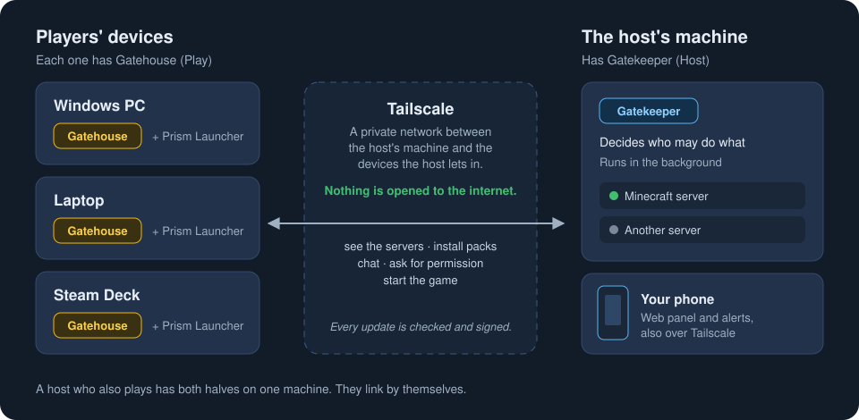</p>

**Gatehouse** is one program with two halves:

- **Play** (the Gatehouse launcher) goes on every device someone plays on. It lists the servers you may join,
  installs and updates their mods, has chat, and starts Minecraft for you.
- **Host** (Gatekeeper) goes on the one machine that runs the Minecraft servers. It decides who may see, join, start
  and stop each server.

Most people only need **Play**. If you run the server, you set up **Host** too.

**Contents**

1. [Playing](#1-playing)
2. [Hosting](#2-hosting)
3. [Inviting a friend](#3-inviting-a-friend)
4. [Everyday playing](#4-everyday-playing)
5. [Everyday hosting](#5-everyday-hosting)
6. [Your phone](#6-your-phone)
7. [Updates](#7-updates)
8. [Steam Deck and controllers](#8-steam-deck-and-controllers)
9. [When something goes wrong](#9-when-something-goes-wrong)
10. [Quick answers](#10-quick-answers)
11. [Words used here](#11-words-used-here)

---

## 1. Playing

<p align="center">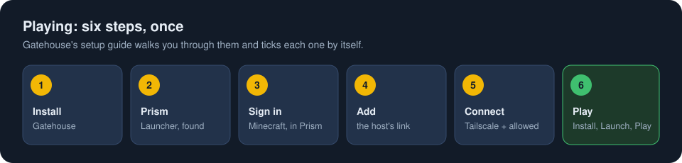</p>

**You need:** Minecraft: Java Edition on your Microsoft account, a Windows 10 (or later) PC, a Linux computer or a
Steam Deck, and a link or file from your host.

### Step 1. Install Gatehouse

| On | Do this |
| --- | --- |
| **Windows** | Download [gatehouse-install.zip](https://github.com/scholar-andrew/gatehouse/releases/latest/download/gatehouse-install.zip), unpack it, double-click **Install Gatehouse.cmd** and choose **Gatehouse**. |
| **Steam Deck or Linux** | On a Deck, switch to Desktop Mode (Steam button, Power, Switch to Desktop) and open **Konsole**. Type the two lines below, pressing Enter after each. |

```bash
curl -fsSLO https://raw.githubusercontent.com/scholar-andrew/gatehouse/main/installer/gatehouse-install.sh
```

```bash
bash gatehouse-install.sh
```

The installer offers anything that's missing (Prism Launcher, and Java on Windows), adds **Gatehouse** to your Start
menu or applications menu, and offers to add it to Steam. It needs no administrator password.

> Joining **October Journey**? Its own installer does all of this plus the modpack in one go: see
> [INSTALL.md](../INSTALL.md).

### Steps 2 to 6. Follow the setup guide

Open **Gatehouse**. The first time, it opens on its **setup guide**. Each step has a button and ticks green by itself
once it's done, so you can't get lost.

<p align="center">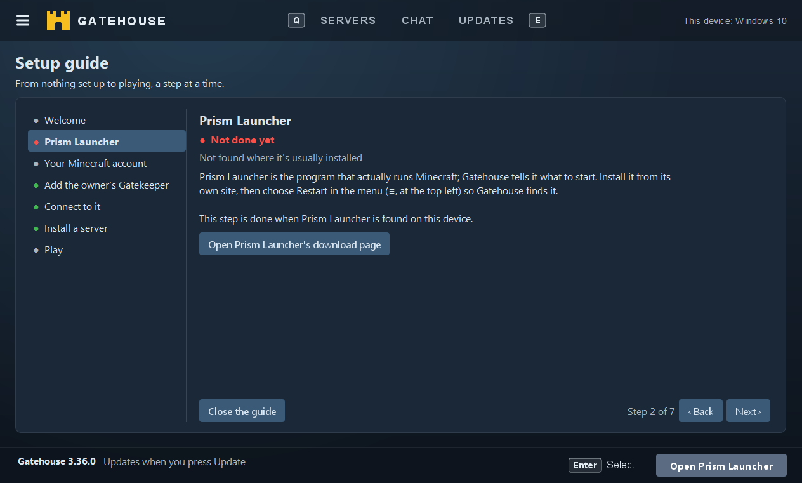</p>

| Step | What to do |
| --- | --- |
| **Prism Launcher** | Ticks when Gatehouse finds it. If you just installed it, choose **Restart** in the menu (the three lines, top left). |
| **Your Minecraft account** | Press **Open Prism Launcher**. In Prism: **Accounts**, **Add Microsoft**, sign in. Gatehouse never sees your password. |
| **Add the owner's Gatekeeper** | Press **Add Gatekeeper...** and paste the link your host sent, or open the file they sent. |
| **Connect to it** | Install [Tailscale](https://tailscale.com/download) and sign in (free). Press **Open invite** to accept your host's invite. Then wait for your host to allow you. |
| **Install a server** | Pick the server and press **Install**. Gatehouse says how much it will download and asks first. |
| **Play** | Press **Launch**, then **Play**. |

You can open the setup guide again any time from the menu: **Setup guide**.

---

## 2. Hosting

<p align="center">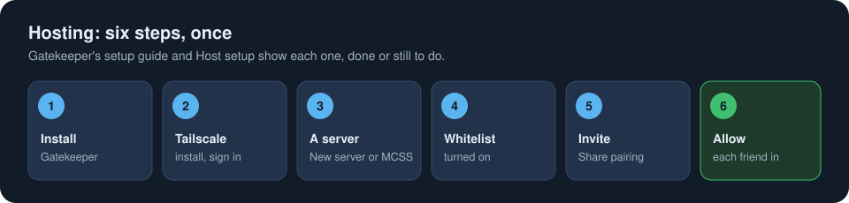</p>

**You need:** a computer that stays on while people play (Windows 10 or later, Linux, or a Steam Deck), Java 17 or
newer, and a free Tailscale account.

### Step 1. Install Gatekeeper

| On | Do this |
| --- | --- |
| **Windows** | The same [gatehouse-install.zip](https://github.com/scholar-andrew/gatehouse/releases/latest/download/gatehouse-install.zip), but choose **Gatekeeper**, or **Both** if you also play on this PC. |
| **Steam Deck or Linux** | In Konsole, the same first line as for playing, then `bash gatehouse-install.sh --gatekeeper`. On a Deck, install Prism Launcher from Discover and open it once first: Gatekeeper uses the Java it fetches. |

Gatekeeper then starts by itself whenever you sign in, with no window. **Gatekeeper** in the Start menu (or
applications menu) opens its window when you want to look or change something.

### Steps 2 to 6. Follow Gatekeeper's setup guide

Gatekeeper's window opens on its own setup guide the first time.

<p align="center">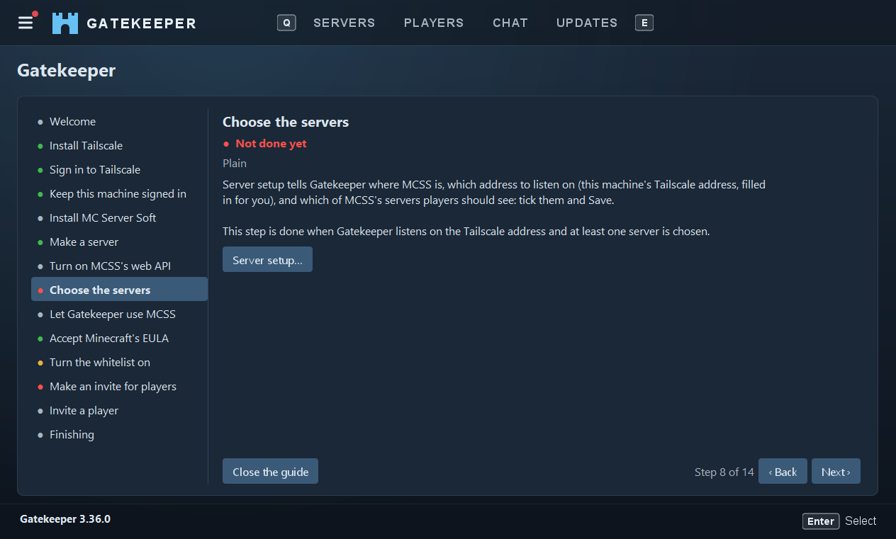</p>

The dots mean: **green** done, **red** still to do, **amber** worth changing, **grey** not needed on this machine.
**Host setup** in the menu shows every check on one page, with its fix:

<p align="center">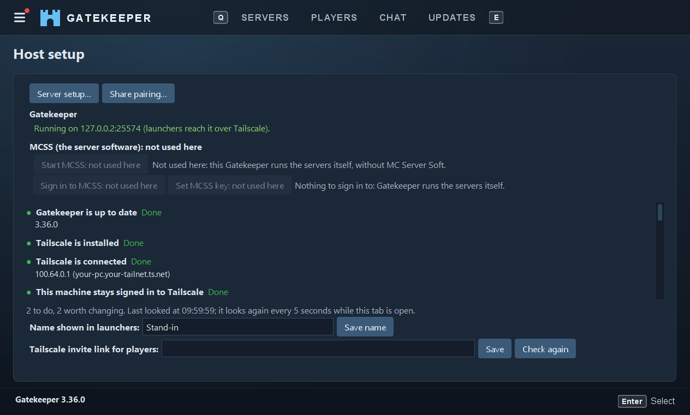</p>

The steps, in plain words:

1. **Tailscale.** Install it, sign in, and wait for **Connected**.
2. **Keep this machine signed in.** On Tailscale's website: **Machines**, this machine's **...** menu,
   **Disable key expiry**. Otherwise your friends lose the server months from now. On Windows, also turn on **Run
   unattended** in Tailscale's menu.
3. **A server.** The easy way: **New server** on the Servers page (below). If you already use MC Server Soft (MCSS)
   on Windows, the guide shows how to connect it instead.
4. **Whitelist on.** Host setup has a button for it. Only players you allow can then join.
5. **An invite for players.** On Tailscale's website: **Machines**, this machine, **Share**, a reusable link. Paste
   it into Host setup and press **Save**. It shares this one machine, nothing else on your network.
6. **Allow each friend** when they turn up in **Players** ([part 3](#3-inviting-a-friend)).

### Making a server

On the **Servers** page press **New server...**:

<p align="center">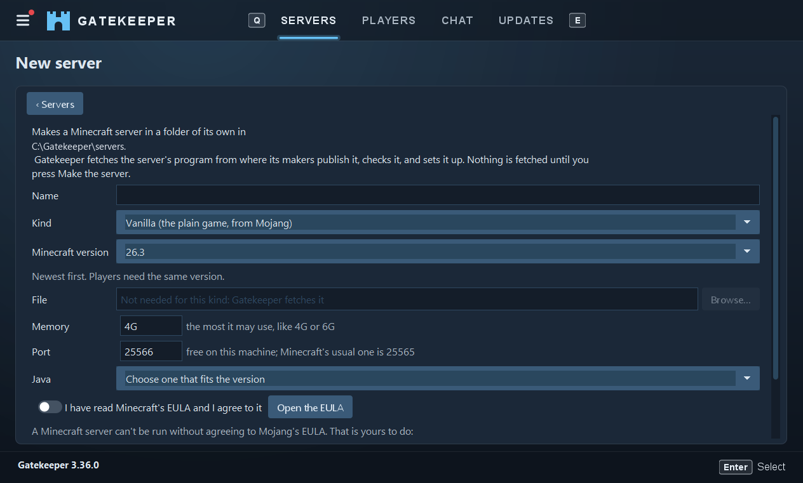</p>

1. Give it a **name**.
2. Pick its **kind**: **Vanilla** (the plain game), **Paper** (plugins), **Fabric** (mods), **Forge or NeoForge**,
   or a server program you already have.
3. Pick the **Minecraft version**. Your players need the same one.
4. Leave **memory**, **port** and **Java** as they are, unless you know you want something else.
5. Read [Minecraft's EULA](https://aka.ms/MinecraftEULA), switch on **I have read Minecraft's EULA**, and press
   **Make the server**.

Nothing is downloaded until you press the button, and it comes only from the game's own publishers, checked.

---

## 3. Inviting a friend

| Host | Friend |
| --- | --- |
| 1. Gatekeeper, menu, **Host setup**, **Share pairing...** Send the link (or the small file) to your friend. | |
| | 2. In Gatehouse: **Add Gatekeeper...**, paste the link. |
| | 3. Accept the Tailscale invite (**Open invite**). |
| 4. Your friend's launcher appears in **Players**, waiting. Allow **Whitelist** for the server, and anything else you like. | |
| | 5. **Install**, **Launch**, **Play**. |

The link on its own gives nothing away: a new launcher can do nothing until you allow it.

<p align="center">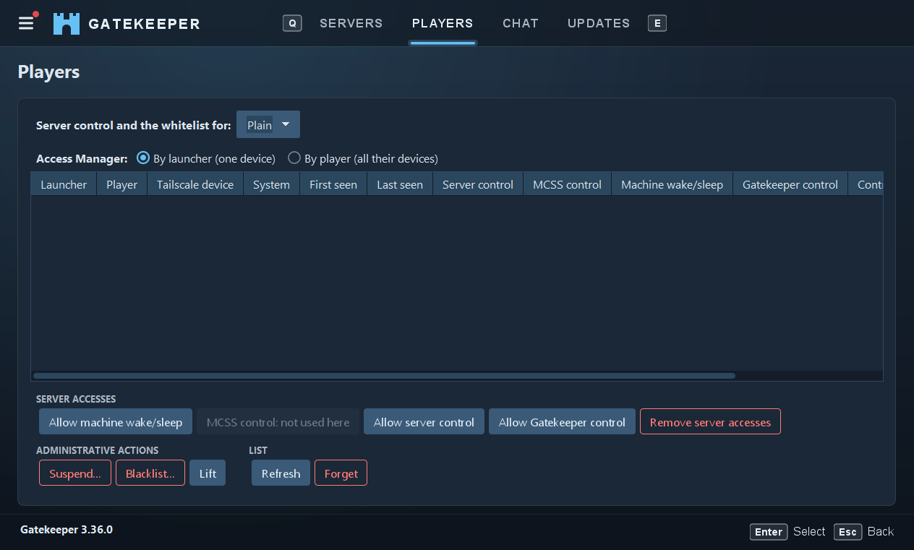</p>

**What you can allow** (per launcher, or per player for all their devices):

| Permission | Lets them |
| --- | --- |
| **Whitelist** | Join that server |
| **Server control** | Start and stop that server |
| **MCSS control** | Start and close MCSS itself (Windows with MCSS only) |
| **Machine wake/sleep** | Wake your machine and put it to sleep |
| **Gatekeeper control** | Manage other players' access from their own launcher |

Each box is **green** (allowed), **white** (nobody decided yet; they can ask) or **red** (denied). Click to change.
**Suspend** and **Blacklist** stop someone, with a reason they'll see; **Lift** undoes it.

**Who sees a server at all?** Each server is **private** (the default: only people you allowed), **shareable**
(also people your players invite) or **public** (everyone who connects). Set it on the server's **Pack** tab, where
you can also make an **invite code**: good for seven days, it lets people see and install the server, nothing more.

---

## 4. Everyday playing

Open **Gatehouse**. It always starts on your servers.

<p align="center">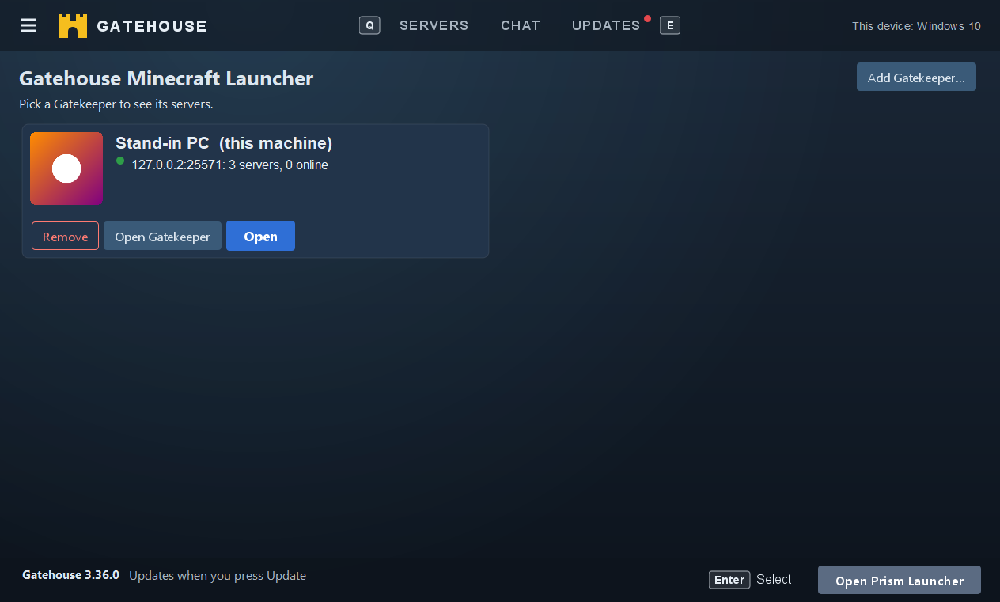</p>

Press **Open** on your host's Gatekeeper to see its servers:

<p align="center">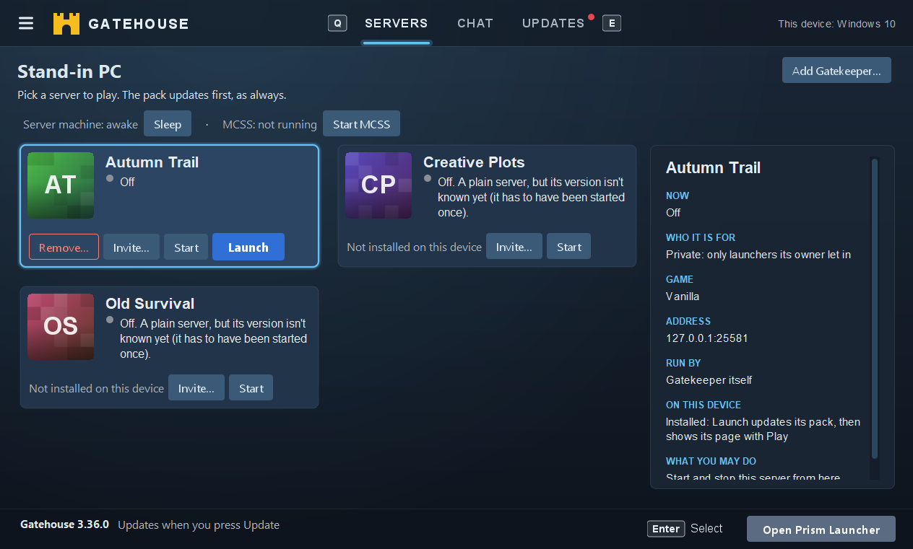</p>

| You want to | Do this |
| --- | --- |
| **Play** | **Launch** on the server's card (it updates the mods), then **Play**. |
| **Play, but the server is off** | **Start** if your host allowed it, or **Request server** on the server's page. Play lights up by itself when it's on. |
| **Install another server** | Its **Install** button. |
| **Remove a server from this device** | **Remove...** on its card (close Prism Launcher first). The server itself isn't touched. |
| **Bring a friend** | **Invite...** on the card gives a code, if the host allows sharing. |
| **Talk to the others** | **CHAT** at the top. |
| **See what's new** | **UPDATES** at the top. A red dot means something new arrived. |

**Chat** has a room for each Gatekeeper and each of its servers. A red number shows new messages.
**Paste** and **Attach** share a picture or file; nothing someone shares downloads until you press **View**.

<p align="center">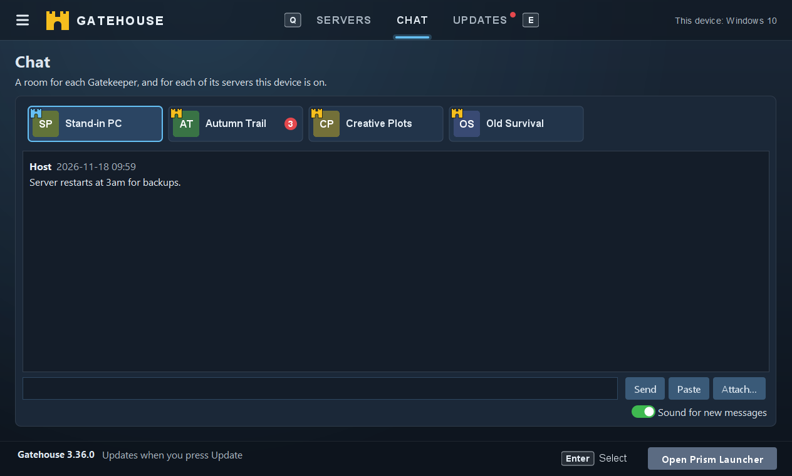</p>

**If a button is missing**, your host hasn't allowed it for your device. The panel beside the server you're on says
**What you may do**, and the server's **Connection** tab shows each permission with **Request permission**.

The **menu** (three lines at the top left) has everything else: your Gatekeepers, Systems, Options, the setup guide,
**User guide** (this page), and **GitHub page**.

<p align="center">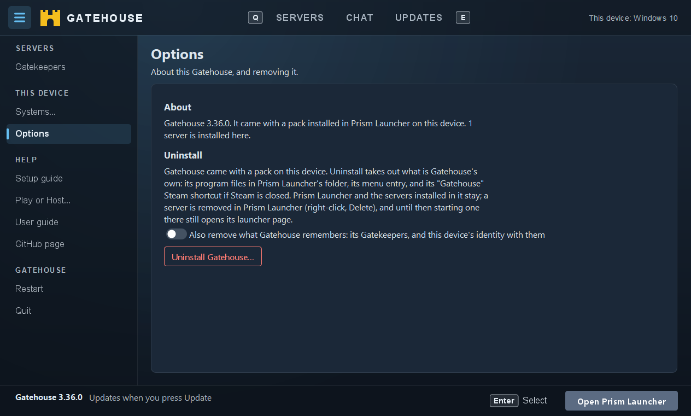</p>

---

## 5. Everyday hosting

Gatekeeper runs in the background. Open its window only to look or change something.

<p align="center">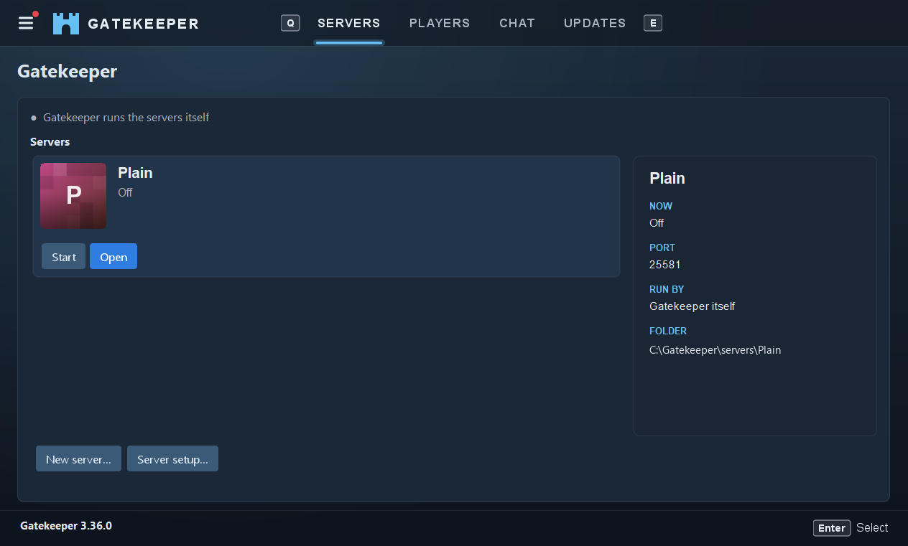</p>

| You want to | Do this |
| --- | --- |
| **Start or stop a server** | **Start** on its card, or **Open** then **Stop**. |
| **Type a server command** | **Open**, **Console** tab. |
| **Change memory, port or game settings** | **Open**, **Settings** or **Game settings** tab. |
| **Back up the world** | **Open**, **Backups** tab. Keeps the newest few. |
| **Restart every night** | **Open**, **Tasks** tab. |
| **Answer a request** | A chime plays and a window shows who asked. Grant it, or dismiss it with a reason. |
| **See who did what** | Menu, **Activity log**. |
| **Talk to players** | **CHAT** at the top. You write as Host. |

The **menu** groups the rest:

<p align="center">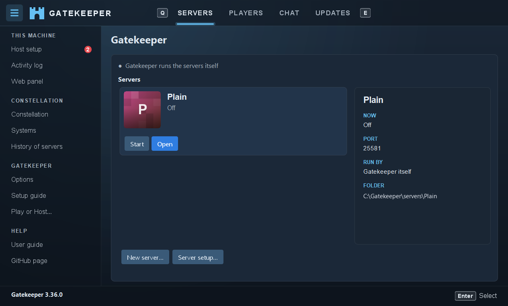</p>

**If a server crashes**, Gatekeeper notices within a minute, tells you (and your phone, if you set that up), and can
start it again by itself: **Settings** tab, **Start it again if it ends without being asked to**.

---

## 6. Your phone

You can watch and control everything from your phone, from anywhere, without opening anything to the internet.

**Set it up once:**

1. Install **Tailscale** on the phone and sign in with the same account as your Gatekeeper's machine.
2. In Gatekeeper: menu, **Web panel**. Press **New account...**, choose a name and a password (10 characters or
   more), and tick **Admin** for yourself.
3. Switch on **The web panel is on**, and open the address it shows on your phone.
4. Optional: add it to your home screen (iPhone: **Share**, **Add to Home Screen**; Android: browser menu,
   **Install**). It then opens like an app.

<p align="center">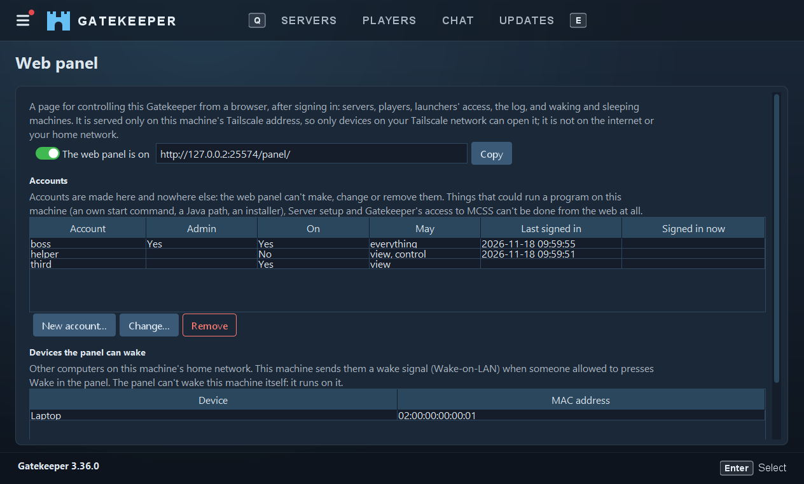</p>

<table align="center"><tr>
<td align="center">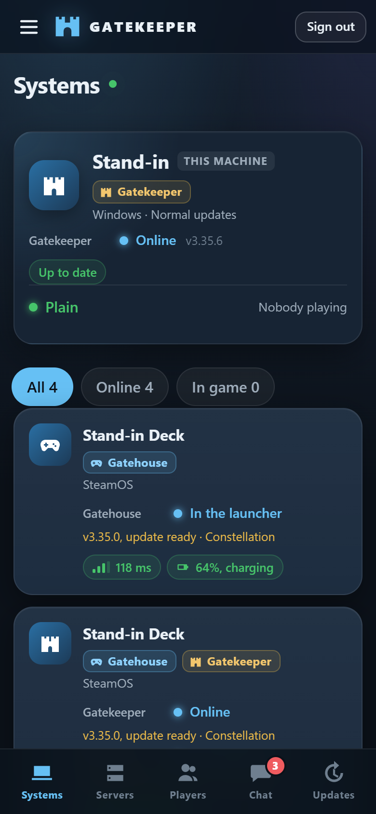<br><b>Systems</b>: every machine at a glance</td>
<td align="center">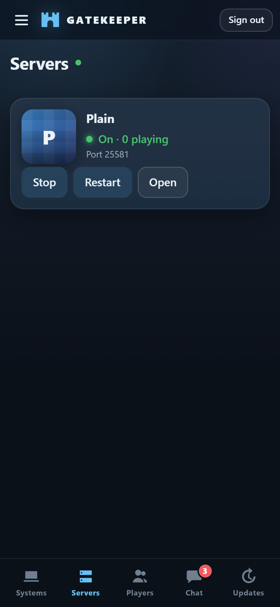<br><b>Servers</b>: start, stop, restart</td>
</tr></table>

The bar along the bottom has **Systems**, **Servers**, **Players**, **Chat** and **Updates**. Accounts that aren't
Admin only see what you let them.

### Phone alerts

Gatekeeper can buzz your phone when a friend joins, a server goes down, an update needs you, someone writes in chat,
or a machine updates. It uses the free **ntfy** app.

1. Install **ntfy** on your phone ([Android](https://play.google.com/store/apps/details?id=io.heckel.ntfy),
   [iPhone](https://apps.apple.com/app/ntfy/id1625396347)).
2. In Gatekeeper: menu, **Options**, **Phone notifications**. Turn them on and tick which kinds you want. (Or from
   the web panel: menu, **Options**.)
3. **Android:** press **Subscribe on this phone** in the web panel. **iPhone:** press **Copy and add in ntfy**, then
   in ntfy press **+**, paste the topic and press **Subscribe**.
4. Press **Send a test**. It should arrive within a few seconds.

The topic is a long random name: keep it to yourself, since anyone who knows it can read the alerts.

---

## 7. Updates

You don't have to do anything: updates are checked against a published checksum and the release signature before
anything is installed, and a bad one is refused.

| | What happens |
| --- | --- |
| **Mods** | **Launch** brings a server's mods up to date every time, before **Play**. It asks before a big download. |
| **Gatehouse** | When a new version is out, a red dot appears on **UPDATES** and the bottom bar says so. How it updates is up to you (below). |
| **Gatekeeper** | Its Servers page says so, with **Update Gatekeeper**. It waits until servers it runs are off. |

Choose how in **UPDATES**, **Update options** (Gatekeeper: **Options**, **Updating**):

<p align="center">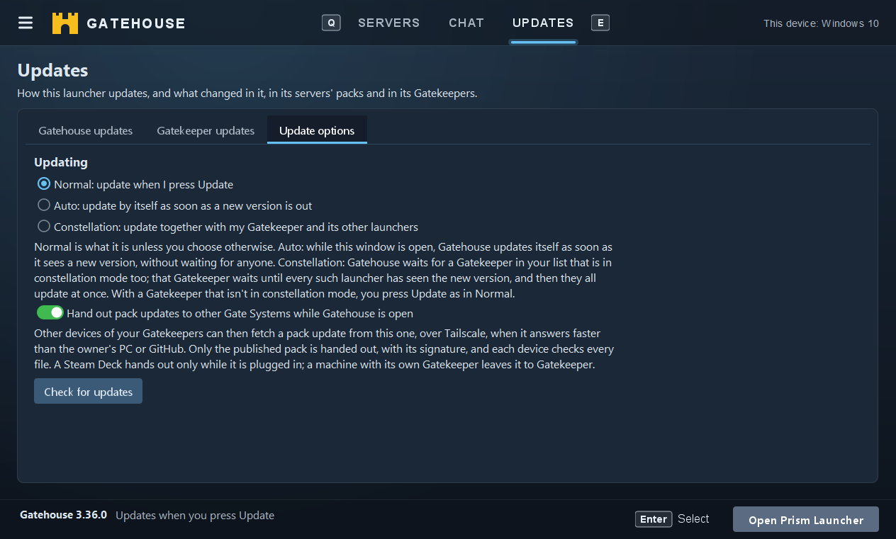</p>

- **Normal:** you press **Update**.
- **Auto:** it updates by itself as soon as a new version is out.
- **Constellation:** every machine waits until all of them have seen the new version, then they all update together.

**Hand out pack updates** lets your devices pass pack updates to each other over Tailscale, whichever is fastest.
Every file is still checked. A Steam Deck only does this while plugged in.

What changed in each version is under **UPDATES**:

<p align="center">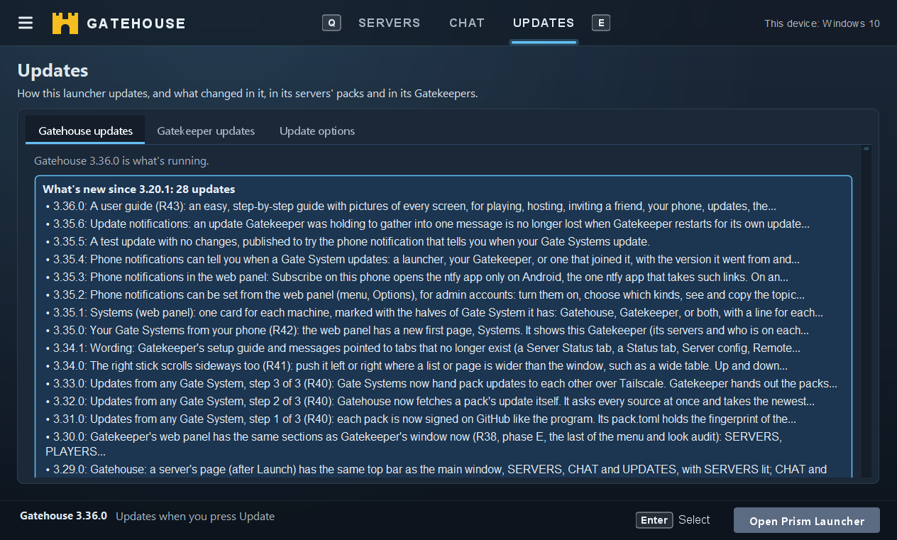</p>

---

## 8. Steam Deck and controllers

- The installer offers to add **Gatehouse** to Steam, so it's there in **Game Mode**.
- Everything works with a controller: the stick or D-pad moves, **A** presses, **B** goes back, the **bumpers** flip
  between the sections at the top, the **View** button opens the menu, the **left trackpad** scrolls when you swipe it (any direction), and the **right stick** scrolls (sideways too,
  on wide pages).
- The bottom bar always shows which button does what, with the controller's buttons or the keyboard's keys,
  whichever you used last.
- **Hosting on a Deck:** keep it plugged in and awake while friends play. A sleeping Deck can't be woken from
  another device. A SteamOS update can remove Tailscale; Host setup tells you when that has happened.

---

## 9. When something goes wrong

**Start here:** open the server in Gatehouse and go to its **Connection** tab. The **network check** finds the first
thing in the way and tells you what to do. It only looks; it changes nothing.

| Problem | Try this |
| --- | --- |
| **"Can't reach the Gatekeeper"** | Is Tailscale on and signed in on this device? Did you accept the host's invite? Is the host's machine on? |
| **"Waiting for the host"** | Your host hasn't allowed your device yet. Ask them to look in **Players**. |
| **Play is greyed out** | The server is off (press **Start** or **Request server**), or you're not on the whitelist (**Request whitelist**). |
| **Minecraft asks me to sign in** | Open Prism Launcher, **Accounts**, and sign in again. |
| **Mods out of date, or the game won't start** | Close the game, press **Restart** in Gatehouse's menu, then **Launch** again. |
| **Players can't join (host)** | Host setup: anything red is the reason. Check Tailscale is **Connected** and key expiry is off. |
| **A server keeps stopping (host)** | Menu, **Activity log**, and the server's **Console** tab, show why. |
| **Steam Deck lost Tailscale** | A SteamOS update removed it: install it again in Desktop Mode, as before. |

**A link that doesn't open:** Gatehouse, Gatekeeper and the web panel try a link before opening it. If it isn't
working, they say why (no internet, the site not found or not answering, the page gone, or your own machine asleep or
off Tailscale), with **Try again** and **Open anyway**.

More: [Troubleshooting](troubleshooting.md). Still stuck? Ask in **Chat**, or open an
[issue on GitHub](https://github.com/scholar-andrew/gatehouse/issues).

---

## 10. Quick answers

**Do I need to keep Gatehouse open?** No, only to launch. Gatekeeper (Host) runs in the background by itself.

**Does it open my computer to the internet?** No. Everything goes over Tailscale, which only connects the host's one
machine and the devices the host lets in. Your router isn't touched.

**Does Gatehouse see my Minecraft password?** No. You sign in inside Prism Launcher, never in Gatehouse.

**Can I play on two devices?** Yes. Your host can allow you per device, or once **by player** for all of them.

**How do I host and play on the same PC?** Install **Both**. The two halves find each other: nothing to pair.

**How do I remove it?** Gatehouse: menu, **Options**, **Uninstall Gatehouse...**. Gatekeeper: **Options**, at the
bottom. Your worlds and servers stay unless you choose otherwise.

---

## 11. Words used here

| Word | Means |
| --- | --- |
| **Gatehouse** | The program. Also its Play half, the launcher. |
| **Gatekeeper** | The program's Host half, on the machine with the servers. |
| **Prism Launcher** | The free program that actually runs Minecraft. Gatehouse tells it what to start. |
| **Tailscale** | A free private network. It lets your devices reach the host's machine without opening anything to the internet. |
| **MCSS** | MC Server Soft, a Windows program some hosts use to run servers. Gatekeeper can run them itself instead. |
| **Pack** | A server's mods and settings, which Gatehouse installs and keeps up to date for you. |
| **Whitelist** | The list of players allowed to join a server. |
| **Gate System** | One machine's Gatehouse, Gatekeeper, or both. |
| **Constellation** | A Gatekeeper and every device connected to it. They can update together. |
| **Web panel** | Gatekeeper's page for your phone or another computer. |
| **ntfy** | A free app that receives Gatekeeper's phone alerts. |

---

Want every detail? [Getting started](getting-started.md) · [Using Gatehouse](gatehouse.md) ·
[Using Gatekeeper](gatekeeper.md) · [Security and privacy](security.md) · [Troubleshooting](troubleshooting.md)
